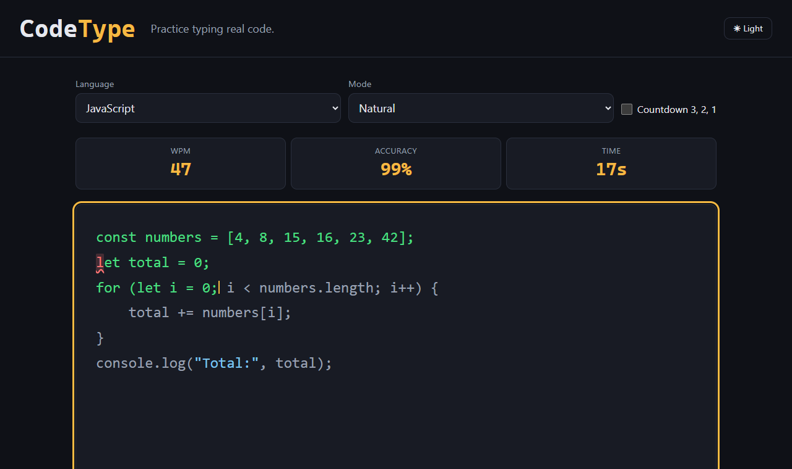
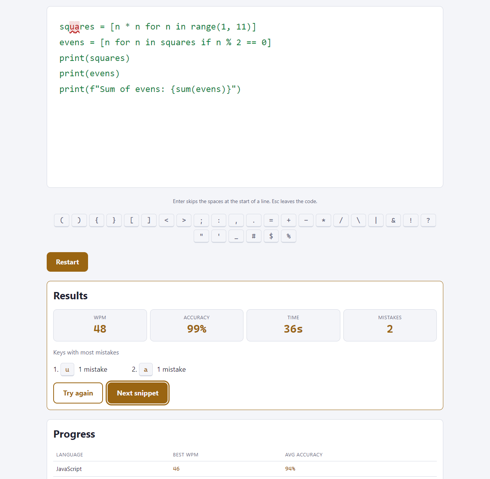
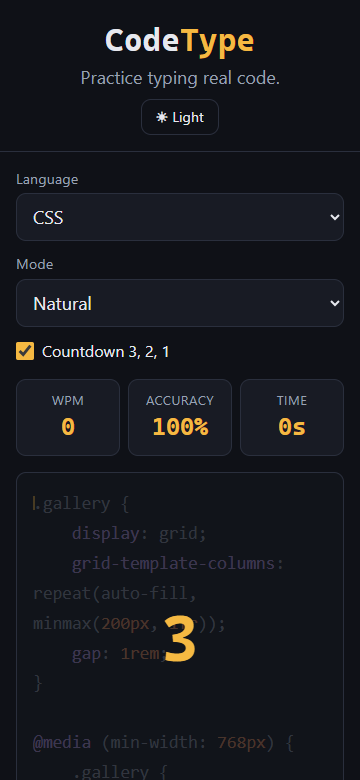

# CodeType

**Practice typing real code.**

CodeType is a typing practice web app for programmers. Normal typing tests use normal sentences. CodeType uses real code instead, with brackets, semicolons, quotes and indentation. You type a code snippet and see your speed (WPM) and accuracy live.

**Live demo:** https://mustypro137.github.io/codetype/



## Features

**Typing**
- One snippet at a time. Typed characters turn green. Mistakes turn red and get a wavy underline.
- **Enter** jumps over the spaces at the start of the next line, so you don't type indentation.
- Two modes:
  - **Natural**: after a mistake you move on.
  - **Strict**: you must type the right key before you can move on.
- **Backspace** fixes mistakes.
- Optional **"3, 2, 1" countdown** before you start.

**Stats and progress**
- Live **WPM**, **accuracy** and **time**. WPM = (correct characters ÷ 5) ÷ minutes.
- **Results panel** at the end: WPM, accuracy, time, mistakes and the 5 keys with the most mistakes.
- **Progress** section: best WPM and average accuracy for each language, and your recent runs. The last 50 runs are saved.

**Look and feel**
- **Syntax colours** for keywords, strings, numbers and comments.
- **Light and dark theme**. On your first visit it follows your computer's theme.
- An on-screen **row of symbol keys**. The next symbol you need lights up.
- Long snippets **scroll smoothly**, so the current line stays in view.

**Your own code**
- **Custom code**: paste any code and practise it. Tabs become 4 spaces, and empty lines at the end are removed.

**Saved in your browser**
- Your language, mode, countdown setting, theme and runs are saved with `localStorage`. Nothing is sent to a server. If the browser blocks storage, the app still works but does not remember anything.

**Accessible**
- Works with the keyboard only. Use **Tab** to reach the code, and **Esc** to leave it while you type.
- Readable colour contrast in both themes.
- Works on phones, tablets and desktops (tested at 360px, 768px and 1280px).
- Lighthouse score: 100 for Performance, Accessibility and Best Practices.

## Languages supported

| Language | Snippets |
|----------|----------|
| JavaScript | 6 |
| Python | 6 |
| HTML | 6 |
| CSS | 6 |
| Java | 6 |
| C | 6 |
| PHP | 6 |
| Custom code | your own |

Each language has snippets from easy to hard (5–15 lines each). To add more, follow the rules in the comment at the top of `data/snippets.js`.

## How to run

**Online:** open the live demo link above.

**On your computer:**
1. Download or clone this repository.
2. Open `index.html` in your browser (double-click it).

That's all. You don't need to install anything. There are no frameworks and no build step.

You can also use the **Live Server** extension in VS Code: right-click `index.html` and choose "Open with Live Server".

## Screenshots

**Dark theme: typing JavaScript, with one mistake**


**Light theme: results and progress after a Python snippet**



**Phone (360px): the countdown before a CSS snippet**



## Tech

- Plain **HTML, CSS and JavaScript**. No frameworks, no libraries, no build tools.
- Normal `<script>` tags (no modules), so `index.html` also works when you open it straight from your disk.
- All file paths are relative, so it works on **GitHub Pages**.

## Folder structure

```
index.html            the page
css/style.css         all styles; colours are CSS variables (dark and light)
data/snippets.js      the code snippets (SNIPPETS array)
js/snippets.js        reads the snippet data
js/storage.js         saves settings and runs in localStorage
js/highlight.js       syntax colours (a small regex per language)
js/theme.js           light/dark theme
js/stats.js           timer, WPM and accuracy
js/results.js         results panel
js/progress.js        progress section
js/custom.js          custom code textarea
js/countdown.js       "3, 2, 1" countdown
js/keyboard.js        on-screen symbol keys
js/engine.js          the typing engine (keys, cursor, colours)
js/main.js            connects everything; runs last
images/               favicon and screenshots
CONTRIBUTION-LOG.md   what I did, what AI did, what I learned
```

## What I learned

<!-- Write this part yourself, in your own words. A few short points for each heading are enough.
     Ideas: look at the "What I learned" column in CONTRIBUTION-LOG.md. -->

**HTML and CSS**
- _(For example: what you learned about CSS variables, media queries, or `hidden`.)_

**JavaScript**
- _(For example: events, `keydown`, `localStorage`, regex, splitting code into files.)_

**Accessibility**
- _(For example: contrast, keyboard-only use, labels, focus.)_

**Working with AI**
- _(For example: what AI helped with, what you checked yourself, what you would do differently.)_

## Credits

Built by [Mustypro137](https://github.com/Mustypro137) as a learning project, with help from an AI assistant (Claude). See `CONTRIBUTION-LOG.md` for who did what.
